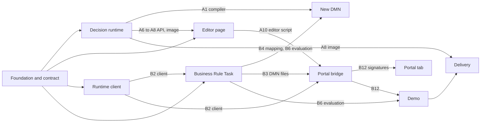

# Implementation plan

This document splits the Axon Ivy Rules Engine into features that two developers can build in parallel. Each
feature is split into stories, and each story into small pull requests. It follows the code of this repository:
every PR names the files where the proof of concept already does what the PR asks for.

Out of scope: the tutorial (`rule-engine-doc`) and its walkthrough builder
(`rule-engine-doc/internal/interactive_app_builder`).

## How to read it

- **Feature**: a workstream with its own module or package.
- **Story**: a capability that users or other features can rely on once its PRs are merged.
- **PR**: one reviewable step. It builds, brings its own tests and leaves `mvn verify` green.
- **Name of a PR**: its prefix says who builds it, its number the order within that prefix.
  - **F**: the foundation. It comes first; F3, the Portal import, needs no work.
  - **A**: Developer A, the decision runtime, its editor page, the DMN generator, the Portal tab and the tests
    against the container.
  - **B**: Developer B, the client of the runtime, the Business Rule Task, New DMN, the Rule Management bridge, the
    demo and the Market product.

Each PR lists its **scope**, its **outcome**, its **acceptance criteria**, what it **depends on**, and a
**reference**: where the proof of concept has it.

## Rules for every PR

- `mvn verify` stays green. Tests come in the same PR as the code they test.
- A PR that changes the build, a command or a design decision updates the root `README.md`. The user documentation,
  `rule-engine-product/README.md`, is written in PR B18, from the features as they are by then.
- Contracts change first, in a PR of their own, so that both developers work against them without waiting for each
  other:
  - the API records of the runtime and of the connector, and `rule-engine/runtime/openapi.yaml` (PR F2). A PR that
    changes a record changes both sides; `ContractTest` fails if it does not;
  - the callable signatures of the Portal bridge (PR B12, signatures listed there).
- The packages `api` and `dmn.generator` of the connector are plain Java 21 without the Ivy API, because the tests of
  the runtime compile them.
- The connector is tested against `MockRuntime` (PR B2), never the real runtime. Tests against the container come
  only in A19 and A20.
- Several features touch the same files: `MockRuntime.java`, `rule-engine-test/process/RuleTest.p.json` and the two
  READMEs. In those, add new parts; do not reorder or reformat what is there, so that merges stay trivial.

## Features

| Feature | Module | Stories | PRs | Needs first |
| --- | --- | --- | --- | --- |
| Foundation and contract | root, `rule-engine`, `rule-engine/runtime` | 2 | F1, F2 | nothing |
| Decision runtime | `rule-engine/runtime` | 5 | A1 to A9 | the foundation |
| DMN editor page of the runtime | `rule-engine/runtime` (`/editor/`), `internal/editor-smoke` | 2 | A10 to A13 | A8 for A10, and A6 for A11 |
| Client of the runtime | `rule-engine` (`client`) | 2 | B1, B2 | the foundation |
| Business Rule Task | `rule-engine` | 5 | B3 to B9 | B2 |
| New DMN from process data | `rule-engine` (`dmn.generator`, `program.internal`) | 2 | A14, B10, B11 | A1 and B4 for A14, and B6 for B10 |
| Rule Management bridge | `rule-engine` (`portal`, `process/Portal`) | 2 | B12 to B14 | B3, and A10 for B14 |
| Rule Management tab in the Portal | `portal`, `portal-components` | 4 | F3, A15 to A18 | nothing for F3; the signatures of B12 for A15 |
| Demo | `rule-engine-demo` | 2 | B15 to B17 | B7 and B12 |
| Delivery | `rule-engine-product`, `rule-engine-test` | 2 | B18, A19, A20 | A8, and the features it ships |

## Parallel plan

Two developers, one for each prefix. The foundation comes first: F1, then F2. F3 is the Portal import and needs no
work.

| Developer | PRs, in order | Starts after |
| --- | --- | --- |
| A | A1 → A2 → A3 → A4 → A5 → A6 → A7 → A8 → A9 → A10 → A11 → A12 → A13 → A14 → A15 → A16 → A17 → A18 → A19 → A20 | F2 |
| B | B1 → B2 → B3 and B4 → B5 → B6 → B7 → B8 and B9 → B10 → B11 → B12 → B13 → B14 → B15 → B16 → B17 → B18 | F1 for B1, F2 for B2 |

Where one developer needs a PR of the other:

| PR | Needs | Why |
| --- | --- | --- |
| A14 DMN generator | B4 | a test of the mapping maps an Ivy data class to DMN types |
| A15 Detect the rule engine and show the tab | B12 | the signatures of the bridge; until B12 is merged, a stub callable with the same signatures |
| A17 Edit a model in the Portal | B13, B14 | saving and activating, and the editor script served by the engine |
| A19 Container test harness | B15 | the tests run the demo process |
| A20 End-to-end scenarios | B8, B17 | the inputs of the active version, and the table that decided |
| B10 New DMN when the element runs | A14 | the generator |
| B14 Editor script served by the engine | A10 | the script comes from the editor bundle of the runtime |

The longest chain is F1 → F2 → A1 → A2 → A3 → A4 → A5 → A7 → A8 → A10 → B14 → A17 → A18.
Review the PRs on it first.

### Milestones

| Milestone | What works | PRs |
| --- | --- | --- |
| M1 A decision evaluates | A process with a Business Rule Task evaluates a `.dmn` file of its project on a runtime in dev mode. | F1, F2, A1 to A5, B1 to B6 |
| M2 Rules change without deployment | Versions, activation, rollback, the container image, the editor page, auto-deploy, the Java API. | A6 to A8, A10 to A12, B7 to B9 |
| M3 Rule owners in the Portal | The tab Rule Management: list, edit, save, activate, roll back. | B12 to B14, F3, A15 to A18 |
| M4 Ready to ship | New DMN, the demo, the product, the tests against the container, the performance baseline. | A9, A13, A14, B10, B11, B15 to B18, A19, A20 |

### All PRs at a glance

| PR | Title | Depends on | Developer | Branch |
| --- | --- | --- | --- | --- |
| F1 | Maven reactor and empty modules | none | foundation | `01.maven.init` |
| F2 | API records and OpenAPI contract | F1 | foundation | `02.core.api-contract` |
| A1 | DMN compiler and evaluator | F2 | A | `03.runtime.dmn-compiler` |
| A2 | Version store and schema | A1 | A | `04.runtime.version-store` |
| A3 | Version life cycle | A2 | A | `05.runtime.version-lifecycle` |
| A4 | Model registry and version service | A3 | A | `06.runtime.model-registry` |
| A5 | REST API: load, read and evaluate | A4 | A | `07.runtime.rest-api` |
| A6 | REST API: life cycle of versions | A5 | A | `08.runtime.version-api` |
| A7 | API key, health and start page | A5 | A | `09.runtime.api-key` |
| A8 | Container image and Docker Compose | A7 | A | `10.runtime.docker` |
| A9 | Performance baseline | A5 | A | `11.runtime.performance` |
| A10 | Bundle the KIE DMN editor | A8 | A | `12.editor.bundle` |
| A11 | Editor page: open, check and save a model | A6, A10 | A | `13.editor.page` |
| A12 | Editor page: versions | A11 | A | `14.editor.versions` |
| A13 | Editor page: project files and new models | A11 | A | `15.editor.files` |
| B1 | HTTP transport | F1 | B | `16.client.transport` |
| B2 | Typed client, configuration and mock runtime | F2, B1 | B | `17.client.typed` |
| B3 | DMN files of a project | B2 | B | `18.connector.dmn-files` |
| B4 | Mapping by name | F2 | B | `19.connector.mapping` |
| B5 | Program element and inscription mask | B3 | B | `20.connector.element` |
| B6 | Evaluate the decision | B4, B5 | B | `21.connector.evaluate` |
| B7 | Register the DMN files as versions | B6 | B | `22.connector.auto-deploy` |
| B8 | Inputs of the version that answers | B7 | B | `23.connector.active-inputs` |
| B9 | Java API RuleEngine | B7 | B | `24.connector.java-api` |
| A14 | DMN generator | A1, B4 | A | `25.generator.dmn` |
| B10 | New DMN when the element runs | B6, A14 | B | `26.newdmn.runtime` |
| B11 | New DMN in the Designer | B10 | B | `27.newdmn.designer` |
| B12 | Bridge: read rules | B3 | B | `28.bridge.read` |
| B13 | Bridge: change rules | B12 | B | `29.bridge.write` |
| B14 | Editor script served by the engine | A10, B12 | B | `30.bridge.editor-script` |
| F3 | Import Portal 14.0.1 unchanged | none | nobody | `31.portal.import` |
| A15 | Detect the rule engine and show the tab | B12, F3 | A | `32.portal.detect` |
| A16 | The table of rules | A15 | A | `33.portal.rules-table` |
| A17 | Edit a model in the Portal | B13, B14, A16 | A | `34.portal.edit` |
| A18 | Versions of a model in the Portal | A17 | A | `35.portal.versions` |
| B15 | Invoice pricing process | B7, B12 | B | `36.demo.process` |
| B16 | Demo dialog | B15 | B | `37.demo.dialog` |
| B17 | Show the table that decided | B9, B16 | B | `38.demo.rules-table` |
| B18 | Market product | B16 | B | `39.product.market` |
| A19 | Container test harness | A8, B15 | A | `40.test.container-harness` |
| A20 | End-to-end scenarios | B8, A14, B17, A19 | A | `41.test.end-to-end` |

### Branches

Each PR has a branch `NN.area.topic`, where `NN` is its place in the merge order, the order of the table above. The
branches are stacked: each one starts from the branch before it, and its PR targets that branch, so a PR shows only its
own change. Merge them in order; when a branch is merged and deleted, GitHub moves the next PR onto `main`.

The name of a PR says who builds it, the number of its branch where it is in the stack. The developers still work in
parallel: each opens the next PR on top of the latest branch it depends on.

---

## Foundation and contract

The foundation comes before the work of the two developers. It is small on purpose: everything after it
builds on it.

### Story: The build exists

#### F1 Maven reactor and empty modules

- **Scope**
  - The root `pom.xml` with the modules `rule-engine`, `rule-engine/runtime`, `rule-engine-demo` and
    `rule-engine-test`, all empty but buildable. Maven deploy is skipped. `rule-engine-product` joins in PR B18.
  - `rule-engine` is the Ivy connector. Its iar leaves out the folder `runtime` (`iarExcludes`).
  - `rule-engine/runtime` is a Quarkus application on Java 21. It lies in the folder of the connector, but shares no
    code with it, only JSON, so the image needs no Ivy tooling.
  - Only the tests of the runtime compile code of the connector: build-helper adds `../src` as a test source folder,
    and the `testIncludes` of the compiler limit it to the packages `api` and `dmn.generator`.
  - `application.properties` with port 8080, and 8090 in dev mode.
- **Outcome**: all modules build together; the runtime starts in dev mode.
- **Acceptance**
  - `mvn verify` passes from the root.
  - `mvn quarkus:dev -f rule-engine/runtime` answers `http://localhost:8090/q/health`.
  - The iar of `rule-engine` contains no file of `runtime`.
  - Try both once in review:
    - the main code of the runtime does not compile if it uses a class of the connector;
    - a class in `api` or `dmn.generator` that imports `ch.ivyteam.ivy.environment.Ivy` breaks the tests of the runtime.
- **Depends on**: nothing.
- **Reference**: `pom.xml`, `rule-engine/pom.xml`, `rule-engine/runtime/pom.xml`, the root `README.md` (decision "One
  project, two deployables").

### Story: Runtime and connector speak one contract

#### F2 API records and OpenAPI contract

- **Scope**
  - The records of the runtime, `com.axonivy.utils.rule.engine.runtime.api.model`, with OpenAPI annotations:
    - requests: `EvaluateRequest`, `RegisterVersionRequest`, `ActivateRequest`, `ValidateRequest`;
    - answers: `EvaluateResponse` (model, version, decision, result, results), `ModelInfo` (decisions with their
      required inputs, inputs), `ModelVersion`, `ValidationResult`;
    - `Message`, and `ErrorResponse` (code, message, details);
    - the enums `VersionSource` (PROJECT, PORTAL, API) and `VersionStatus` (DRAFT, APPROVED, ACTIVE, RETIRED).
  - The records of the connector, `com.axonivy.utils.rule.engine.api`: the same fields, with Javadoc instead of OpenAPI
    annotations, and with builders for `EvaluateRequest` and `RegisterVersionRequest`. There is no `ValidateRequest`:
    the client sends that one field without a record.
  - `ContractTest` in the runtime: the records of both sides have the same fields with the same types, and the enums
    the same constants. It does not compare JSON annotations such as `@JsonInclude`.
  - `FeelNames` and `BeanProperties`, in the package `dmn.generator` of the connector: the naming rules and the
    reading of data class properties that the mapping (B4) and the generator (A14) share. They are in this PR so that
    both can start at once.
  - `rule-engine/runtime/openapi.yaml`: the 14 operations under `/api` and the error codes INVALID_REQUEST,
    INVALID_MODEL, UNAUTHORIZED, MODEL_NOT_FOUND, VERSION_NOT_FOUND, DECISION_NOT_FOUND, NO_ACTIVE_VERSION,
    INVALID_STATE, EVALUATION_FAILED and INTERNAL_ERROR.
- **Outcome**: the runtime and the connector are written against one contract, each with records of its own. A
  difference between them fails the build.
- **Acceptance**
  - The records of both sides turn into the JSON that `openapi.yaml` describes and back again (unit tests in the
    runtime module, whose tests compile the records of the connector too).
  - Renaming a field, or adding an enum constant, on one side only makes `ContractTest` fail. Try it once in review.
  - `FeelNames` and `BeanProperties` have unit tests:
    - names reserved in FEEL are renamed, and found back;
    - names of built-in functions keep their name;
    - field paths get the shortest name that is unique;
    - data class properties are found in declaration order.
- **Depends on**: F1.
- **Reference**: `rule-engine/runtime/src/main/java/.../runtime/api/model/`,
  `rule-engine/src/com/axonivy/utils/rule/engine/api/`, `rule-engine/src/.../dmn/generator/FeelNames.java`,
  `ContractTest.java`, `rule-engine/runtime/openapi.yaml`.

---

## Decision runtime

A Quarkus service that loads DMN models at runtime, keeps all their versions and evaluates decisions. Based on
`kie-dmn-core` of Apache KIE 10.2.0, interpreted: no code generation, no KieContainer, no restart.

### Story: A DMN model loaded at runtime can be evaluated

#### A1 DMN compiler and evaluator

- **Scope**
  - `DmnCompiler`:
    - compiles DMN XML in memory with `DMNRuntimeBuilder`, and reads DMN 1.1 to 1.6;
    - validates with `DMNValidator` against the schema, the model rules and the compiler;
    - first checks that the content is a DMN document at all.
  - `DmnEvaluator`: evaluates one named decision, or all of them.
  - `CompiledModel`: its decisions and inputs, as `ModelInfo`.
  - `InvalidModelException` and `Messages`, which turn KIE messages into readable ones.
  - The option `rule.engine.type-check` (default `true`): a value outside the allowed values fails the evaluation
    instead of matching no rule.
  - The internal KIE API (`org.kie.dmn.core.internal.utils`) is used in these two classes only.
- **Outcome**: a DMN XML string becomes an executable model without a build.
- **Acceptance**
  - Unit tests cover:
    - a valid model evaluates a named decision and the whole model;
    - empty content, a file that is not DMN, and a model with errors each give readable messages;
    - an enum value outside its allowed values fails while type-check is on.
- **Depends on**: F2.
- **Reference**: `rule-engine/runtime/src/main/java/.../runtime/dmn/`.

### Story: Versions are stored and follow a life cycle

#### A2 Version store and schema

- **Scope**
  - Flyway migration `V1__model_versions.sql`, and `ModelVersionEntity` (Panache) with its queries.
  - An embedded H2 file database under `rule.engine.data-dir`, and an in-memory database for tests.
  - `VersionStore`:
    - `register` stores a version only once per content: SHA-256 of the content, with line endings ignored;
    - `versions`, `get`, `exists`, `delete`, `modelNames`.
  - Version numbers count up per model.
- **Outcome**: versions survive a restart, and the same file is stored once.
- **Acceptance**
  - The same file with CRLF and with LF line endings gives one version.
  - Version numbers count up per model.
  - With the file database, versions are still there after a restart.
- **Depends on**: A1: the tests use its `TestModels`.
- **Reference**: `.../runtime/store/ModelVersionEntity.java`, `.../runtime/service/VersionStore.java`,
  `src/main/resources/db/migration/`.
- **Review note**: versions are stored in the runtime container, not in the system database of the Ivy Engine as
  MARP-4895 describes. Keep it that way, or decide otherwise before this PR.

#### A3 Version life cycle

- **Scope**
  - The statuses draft, approved, active and retired, with exactly one active version per model.
  - The source-of-truth rule (`shouldActivate`):
    - an explicit choice of the caller wins;
    - the first version of a model goes live;
    - an effective date means "go live at that time";
    - a project version replaces a project version;
    - everything else stays a draft.
  - `approve` works only on a draft.
  - `activate` works now, or at an effective date (the version is then approved and waits).
  - `retire` works only on a version that is not active.
  - `rollback` follows `previousVersion`, so repeated rollbacks walk further back.
  - `activateDueVersions` makes versions live once their effective date is reached.
- **Outcome**: a project deployment never replaces a version that a person activated.
- **Acceptance**
  - One store test per rule, including "a project redeployment does not overwrite a version activated from the
    Portal".
  - Rolling back the first active version answers INVALID_STATE.
  - Retiring the active version answers INVALID_STATE.
- **Depends on**: A2.
- **Reference**: `VersionStore.java` (`shouldActivate`, `activate`, `rollback`).

### Story: The active versions answer at once

#### A4 Model registry and version service

- **Scope**
  - `ModelRegistry`:
    - loads the compiled active version of each model at startup;
    - `sync` swaps a reference, so evaluations that are running keep their version;
    - remembers why a stored version cannot be loaded;
    - keeps non-active versions for test runs in an LRU cache (`rule.engine.version-cache-size`).
  - `VersionService`:
    - one lock for all changes, and a check of model names;
    - `register` validates, compiles, then stores;
    - evaluates the active version, or a given one.
  - A scheduler (`rule.engine.sync-interval`, 5 s) activates due versions and picks up activations made by another
    instance.
  - `RuleEngineException` with its codes.
- **Outcome**: a new active version answers the next evaluation, without a restart.
- **Acceptance**
  - After v2 is activated, the next evaluation answers with version 2.
  - A version with an effective date two seconds ahead goes live after the next sync (1 s in the test profile).
  - A stored version that does not compile answers INTERNAL_ERROR with the reason; other models still work.
  - An unknown decision answers DECISION_NOT_FOUND with the decisions the model has.
- **Depends on**: A3.
- **Reference**: `.../runtime/service/ModelRegistry.java`, `VersionService.java`, `RuleEngineException.java`.

### Story: The runtime has a REST API

#### A5 REST API: load, read and evaluate

- **Scope**
  - Endpoints:
    - `GET /api/models` and `GET /api/models/{model}`;
    - `POST` and `GET /api/models/{model}/versions`, and `GET .../versions/{version}`;
    - `GET .../versions/{version}/content`;
    - `POST /api/models/{model}/evaluate` and `POST /api/validate`.
  - `ErrorMappers` turn every failure into an `ErrorResponse` with the HTTP status of its code.
  - `JsonConfig` writes dates in ISO format.
  - The request body may be up to 20 MB.
  - The OpenAPI document is at `/q/openapi`, Swagger UI at `/q/swagger-ui`.
- **Outcome**: the connector can register a file and evaluate it. This is enough for milestone M1.
- **Acceptance**
  - Tests of `ModelsApiTest`:
    - the runtime starts without a model and loads one through the API;
    - a named decision is evaluated and returns its result;
    - the same content is not stored twice;
    - an invalid DMN is rejected with a readable message;
    - a missing input fails the evaluation.
  - The generated OpenAPI document matches `openapi.yaml` for these operations.
- **Depends on**: A4.
- **Reference**: `.../runtime/api/ModelsResource.java`, `ValidationResource.java`, `ErrorMappers.java`,
  `ModelsApiTest.java`.

#### A6 REST API: life cycle of versions

- **Scope**: `POST .../versions/{version}/approve`, `.../activate` (now or with `effectiveDate`), `.../retire`,
  `POST /api/models/{model}/rollback`, `DELETE /api/models/{model}`, and `POST .../versions/{version}/evaluate`
  (a test run of a draft).
- **Outcome**: every operation of `openapi.yaml` works.
- **Acceptance**
  - Tests of `ModelsApiTest`:
    - a new version replaces the old one without a restart;
    - of several versions, exactly one is active;
    - a rollback activates the previous version;
    - a project redeployment replaces a project version, but does not overwrite a version activated from the
      Portal.
  - A draft can be evaluated before it is active.
  - Delete removes the model from memory too.
- **Depends on**: A5.
- **Reference**: `ModelsResource.java`, `ModelsApiTest.java`.

### Story: The runtime runs in production

#### A7 API key, health and start page

- **Scope**
  - `ApiKeyFilter`:
    - protects `/api/*` with `RULE_ENGINE_API_KEY`, given as `X-API-Key` or as a bearer token;
    - compares keys in constant time;
    - warns at startup when no key is set.
  - `ModelsHealthCheck`: a readiness check that lists the loaded models and the failures.
  - The start page `/` with links to the editor, Swagger UI and health.
- **Outcome**: only the Ivy Engine can call the API, and orchestration can see when the runtime is ready.
- **Acceptance**
  - Tests of `ApiKeyTest`:
    - the API answers 401 UNAUTHORIZED without the key;
    - health stays open;
    - the editor page stays open.
  - `/q/health/ready` is DOWN until the models are loaded.
- **Depends on**: A5.
- **Reference**: `.../runtime/api/ApiKeyFilter.java`, `ModelsHealthCheck.java`,
  `src/main/resources/META-INF/resources/index.html`.

#### A8 Container image and Docker Compose

- **Scope**
  - A multi-stage `Dockerfile`, built from `rule-engine/runtime` alone.
  - The image runs as non-root user 1001, keeps its data in the volume `/data`, has a health check
    (`docker/healthcheck.sh`) and `JAVA_OPTS`, and carries `LICENSE` and `NOTICE`.
  - `docker-compose.yml` in the root: build context `rule-engine/runtime`, port 8090, `RULE_ENGINE_API_KEY`, a named
    volume, TLS options as comments.
  - `.dockerignore` in `rule-engine/runtime`.
- **Outcome**: one generic image for every customer; models are loaded at runtime, never built in.
- **Acceptance**
  - `docker compose up -d --build` becomes healthy.
  - Versions survive `docker compose down` and `up`; `down -v` deletes them.
  - The container runs as uid 1001.
  - The image contains no class of the connector.
- **Depends on**: A7.
- **Reference**: `rule-engine/runtime/Dockerfile`, `rule-engine/runtime/docker/healthcheck.sh`,
  `rule-engine/runtime/.dockerignore`, `docker-compose.yml`.

#### A9 Performance baseline

- **Scope**: `PerformanceBaselineTest` in the Maven profile `performance`. It measures a decision table of 1,000
  rules with 2 inputs and hit policy FIRST, and writes `target/performance-baseline.md`.
- **Outcome**: a baseline to compare against after a KIE or Quarkus upgrade.
- **Acceptance**
  - `mvn test -Pperformance -f rule-engine/runtime` writes the report: validate, compile, evaluation mean, p50,
    p95 and p99 in the engine and through REST, and the throughput with 8 clients.
  - The default build does not run it.
  - The numbers are in the root `README.md`.
- **Depends on**: A5.
- **Reference**: `PerformanceBaselineTest.java`, the root `README.md` (Performance baseline).

---

## DMN editor page of the runtime

The page `/editor/` of the runtime: the Apache KIE DMN editor, the one of the KIE extension for VS Code, plus a
list of models and versions. It needs only a browser.

### Story: The runtime ships the KIE editor

#### A10 Bundle the KIE DMN editor

- **Scope**
  - The runtime build downloads `@kie-tools/dmn-editor-standalone` 10.2.0 from npm, checks its sha512, keeps it in
    the local Maven repository and serves it as `/editor/lib/dmn-editor.js`.
  - HTTP compression is on: the script is 12 MB, about 3 MB compressed.
- **Outcome**: the editor script is part of the image, in the version that fits the DMN engine.
- **Acceptance**
  - `EditorPageTest` checks that the KIE editor is bundled and that its script is served compressed.
  - A wrong checksum fails the build.
- **Depends on**: A8, whose `NOTICE` it extends.
- **Reference**: `rule-engine/runtime/pom.xml` (`dmn.editor.*`, antrun), `EditorPageTest.java`.

### Story: Rule owners edit rules in the browser

#### A11 Editor page: open, check and save a model

- **Scope**
  - `editor/index.html`, `editor.js` and `editor.css`.
  - The page:
    - lists the models of the runtime, with deep links `#<model>` and `#<model>/<version>`;
    - opens the active version in the KIE editor, with undo, redo and a mark for unsaved changes;
    - **Check** shows the findings of the DMN engine;
    - **Save as draft** and **Save and activate** store a new version with source PORTAL, an author and a
      description;
    - asks for the API key once per browser tab when the runtime has one;
    - talks only to `../api/`.
  - The browser check `internal/editor-smoke`:
    - starts a throwaway container with an API key;
    - counts every request that leaves the runtime as a failure.
- **Outcome**: a rule owner changes a rule and makes it live without a deployment.
- **Acceptance**
  - The editor smoke test covers the key prompt, opening a model, changing a rule, and saving and activating it
    (it becomes the active version). A model the runtime rejects shows its findings.
  - `EditorPageTest` checks the page and the link from the start page.
- **Depends on**: A6 and A10.
- **Reference**: `rule-engine/runtime/src/main/resources/META-INF/resources/editor/`,
  `internal/editor-smoke/editor-smoke.mjs`, `internal/README.md`.

#### A12 Editor page: versions

- **Scope**: the list of versions of the selected model, with status, source and author. Open any version,
  activate it, roll back.
- **Outcome**: a wrong change is undone from the browser.
- **Acceptance**
  - The smoke test activates the old version, then rolls back.
  - Each action shows the new active version.
- **Depends on**: A11.
- **Reference**: `editor.js` (versions box, rollback).

#### A13 Editor page: project files and new models

- **Scope**
  - **Open .dmn file…** and **Save file**: Chrome and Edge write the file back with the File System Access API,
    other browsers download it.
  - **New model**, with a name dialog, stored as the first version of the new model.
- **Outcome**: the `.dmn` file of a project can be changed without a Designer.
- **Acceptance**: the smoke test writes a file back, and creates a new model.
- **Depends on**: A11.
- **Reference**: `editor.js` (open-file, save-file, name-dialog).

---

## Client of the runtime

The REST client of the connector, built like the HTTP layer of LangChain4j: a transport abstraction found through
a service provider interface, with the Ivy REST client as the default transport.

### Story: Requests go through a replaceable transport

#### B1 HTTP transport

- **Scope**
  - `client.http`:
    - `HttpClient`, `HttpClientBuilder`, `HttpRequest`, `HttpMethod`, `SuccessfulHttpResponse` and
      `HttpException`;
    - the SPI `HttpClientBuilderFactory`, and `HttpClientBuilderLoader` to find it.
  - `client.http.log.LoggingHttpClient`, which masks secrets in its log.
  - `client.http.ivy`:
    - `IvyHttpClient` and its builder and factory, on the Ivy REST client `ruleEngine` (Jersey), so that calls
      appear in the tracing of the engine;
    - its registration in `META-INF/services`.
  - `config/rest-clients.yaml` with `ruleEngine`: the place for TLS settings. The URL comes from the variable at
    runtime.
- **Outcome**: the connector sends HTTP requests through Ivy, and a test can plug in another transport.
- **Acceptance**
  - The loader finds the Ivy transport as the default.
  - `X-API-Key` and `Authorization` are masked in the logs.
- **Depends on**: F1.
- **Reference**: `rule-engine/src/com/axonivy/utils/rule/engine/client/http/`,
  `src/META-INF/services/...HttpClientBuilderFactory`.

### Story: The connector calls the runtime with typed requests

#### B2 Typed client, configuration and mock runtime

- **Scope**
  - `RuleEngineClient`:
    - its builder takes `baseUrl` (required), `apiKey`, timeouts, `logRequests` and custom headers;
    - `DefaultRuleEngineClient` implements the 14 operations.
  - `Json`, and `ExceptionMapper`, which maps failures to `RuleEngineApiException` (with the code of the runtime and
    `isModelMissing`), `RuleEngineTimeoutException` and `RuleEngineUnreachableException`.
  - `RuleEngine.client()` and `RuleEngine.client(config)`: the entry point that builds the client from the
    variables. PR B9 adds the rest of the Java API.
  - `RuleEngineConfig.fromVariables()` and `config/variables.yaml`:
    - `Url`, `ApiKey` (password), `TimeoutSeconds`, `ConnectTimeoutSeconds`;
    - `AutoDeploy`, `ModelPrefix`, `LogRequests`;
    - `runtimeModel()` adds the prefix.
  - `MockRuntime` in `rule-engine-test`: a stand-in for the runtime that tests program and that records every
    request.
- **Outcome**: Java code in Ivy calls the runtime with the records of the package `api`. Every later connector test
  uses the mock runtime.
- **Acceptance**: tests of `TestRuleEngineClient`:
  - evaluate sends the model, the decision and the input;
  - versions are managed;
  - an error answer becomes an API exception with the code of the runtime;
  - transport failures become timeout or unreachable;
  - the base URL is required.
- **Depends on**: F2 and B1.
- **Reference**: `rule-engine/src/.../client/`, `RuleEngineConfig.java`, `rule-engine/config/variables.yaml`,
  `rule-engine-test/src/.../mock/MockRuntime.java`, `TestRuleEngineClient.java`.

---

## Business Rule Task

The program element that evaluates a DMN decision with process data, without code. Inputs and results are mapped
by name.

### Story: The connector knows the DMN files of a project

#### B3 DMN files of a project

- **Scope**
  - `ProjectDmnFiles` finds the `.dmn` files in the folder `dmn` of the project and of its required projects. In a
    packed project (`.iar`) it reads them as a zip, under `META-INF/ivy`.
  - `LoadedDmn` holds the content, its hash, what the file offers and a parse error. The model name is the file
    name.
  - `DmnModelInfo` reads, with the XML parser of the JDK:
    - the decisions;
    - the inputs each one needs, also through the decisions it requires;
    - the results and their types.
  - The test project gets `dmn/discount.dmn` and `dmn/invoice-approval.dmn`.
- **Outcome**: the mask, the executor and the Portal bridge know what a project offers, without a DMN engine.
- **Acceptance**: tests of `TestProjectDmn`:
  - the files of the project and of its required projects are found;
  - the files of a packed project are found;
  - a decision knows its inputs, also through other decisions;
  - a decision knows its results and their types.
- **Depends on**: B2: a test checks the editor link of its configuration.
- **Reference**: `rule-engine/src/.../dmn/`, `TestProjectDmn.java`, the root `README.md` (decision "Packed
  projects").

### Story: Process data is mapped by name

#### B4 Mapping by name

- **Scope**
  - `FieldLocator` finds the field for a DMN name:
    - breadth-first through nested data classes, and the field closest to the root wins;
    - lists are not searched;
    - names are normalized with `FeelNames`;
    - a nested object is read without being created.
  - `ValueConverter` converts both ways: string, number, boolean, date, date and time, time, duration, enum (as
    string), nested data class (as structure) and list (as collection). A value that does not fit gives a readable
    message.
- **Outcome**: there is nothing to map by hand.
- **Acceptance**: tests of `TestMapping`:
  - data class properties are found in declaration order;
  - Ivy values become JSON and back;
  - fields are found by name, also when only case and blanks differ (`Risk Level` finds `riskLevel`);
  - fields are read without creating nested objects.
- **Depends on**: F2.
- **Reference**: `rule-engine/src/.../mapping/`, `TestMapping.java`, the root `README.md` (decision "Mapping by
  name only").

### Story: A process evaluates a decision

#### B5 Program element and inscription mask

- **Scope**
  - `BusinessRuleTask` with its icon, and the keys of its configuration (`Conf`).
  - `RuleTaskEditor`:
    - group **Decision**: the dropdown **DMN decision** lists `model › decision` for every file;
    - `model › all decisions` appears only when a model has more than one decision;
    - an unreadable file shows a warning;
    - the last entry is **New DMN...**;
    - group **New DMN**: name, input fields and output fields. B10 and B11 use them.
  - The dropdown is the multi-select widget, and the first selected entry counts: the inscription API of 14.0.1 has
    no single select.
- **Outcome**: the element can be placed in a process, and its decision selected.
- **Acceptance**
  - Tests of `TestProjectDmn`:
    - the mask lists the files and their decisions;
    - the mask explains each group once.
  - The mask opens even when the files cannot be listed.
- **Depends on**: B3.
- **Reference**: `BusinessRuleTask.java`, `program/internal/RuleTaskEditor.java`, `Conf.java`,
  `webContent/logo/business-rule-task.png`.

#### B6 Evaluate the decision

- **Scope**
  - `RuleTaskExecutor`:
    - reads the selection;
    - takes the inputs the decision needs from the file, or from the runtime when the project has no file;
    - reads each input from the field of its name (or evaluates it as IvyScript) and evaluates;
    - writes the results back by name. For the whole model, each result goes to its field. A structured result
      fills a data class, or is unfolded into the fields named like its entries.
  - `RuleErrors` raise BPMN errors that `rule:engine` catches:
    - `rule:engine:unreachable` and `rule:engine:timeout`;
    - `rule:engine:dmn`, with the code of the runtime in the attribute `ruleEngineCode`;
    - `rule:engine:mapping`.
  - The case custom field `ruleVersion_<model>` stores the version that decided.
  - Abort interrupts the worker thread.
  - The test process `RuleTest.p.json` and its data classes.
- **Outcome**: milestone M1. A process decides with a `.dmn` file of its project.
- **Acceptance**: tests of `TestBusinessRuleTask`:
  - inputs and results are mapped by name;
  - fields that are not set are sent as null;
  - the whole model maps every result;
  - a structured result fills a data class;
  - all supported types are sent as JSON;
  - a DMN error, an unknown model, an unreachable runtime and a timeout each raise their BPMN error;
  - an input without a field raises a mapping error.
- **Depends on**: B4 and B5.
- **Reference**: `program/internal/RuleTaskExecutor.java`, `RuleErrors.java`, `rule-engine-test/process/RuleTest.p.json`,
  `TestBusinessRuleTask.java`.

### Story: The project's rules reach the runtime by themselves

#### B7 Register the DMN files as versions

- **Scope**
  - `ModelDeployer`:
    - when the project starts (`BusinessRuleTask.start`), registers every file with source PROJECT, if
      `AutoDeploy` is on and a URL is set;
    - before each evaluation, `ensureRegistered` registers a changed file (it keeps one fingerprint per runtime and
      model), so a saved file is live with the next evaluation;
    - when the runtime has lost the model, registers it again and evaluates once more.
  - `ModelPrefix` is applied. If the runtime is unreachable at start, the files are registered with the first
    evaluation.
- **Outcome**: during development, saving a `.dmn` file is enough.
- **Acceptance**: tests with the mock runtime:
  - the start registers each file once;
  - an unchanged file is not sent again, a changed one is;
  - MODEL_NOT_FOUND leads to one new registration and one retry;
  - with `AutoDeploy=false` nothing is registered;
  - the prefix is used.
- **Depends on**: B6.
- **Reference**: `deploy/ModelDeployer.java`, `BusinessRuleTask.java` (`start`).

#### B8 Inputs of the version that answers

- **Scope**
  - `ActiveVersionInputs` asks the runtime for the source and the inputs of the active version, at most every five
    seconds per model.
  - When the active version did not come from a project, the executor also sends its inputs, found by name.
  - When another version answered than expected, it asks again, and evaluates once more if that version needs more
    inputs.
- **Outcome**: a rule owner adds an input column in the Portal, and the process does not change.
- **Acceptance**
  - A Portal version with an extra input gets the value of the field of that name.
  - A project version that answers adds no inputs.
  - At most one extra evaluation happens.
- **Depends on**: B7.
- **Reference**: `deploy/ActiveVersionInputs.java`, `RuleTaskExecutor.java` (`withInputsOfAnsweringVersion`), the root
  `README.md` (decision "Inputs of the version that answers").

### Story: A Rules UI can manage versions from Java

#### B9 Java API `RuleEngine`

- **Scope**: the rest of `RuleEngine`: `evaluate`, `versions`, `register`, `approve`, `activate` (now or at a
  date), `rollback`, `retire`, `deploy(project)`, and `export(model, version, project)`. Export writes the version
  back to `dmn/<model>.dmn`, which needs the project folder of the Designer.
- **Outcome**: live rules can be brought back into the project, and a custom UI can manage versions.
- **Acceptance**: tests with the mock runtime:
  - every method sends the right request;
  - `export` writes the file;
  - `deploy` returns the registered versions.
- **Depends on**: B7.
- **Reference**: `RuleEngine.java`, `rule-engine-product/README.md` (Java API for a Rules UI).

---

## New DMN from process data

The user selects fields of the process data and gets a ready-to-edit `.dmn` file; only the rules are left to
write.

### Story: A DMN model is generated from fields

#### A14 DMN generator

- **Scope**
  - In `rule-engine`, package `dmn.generator`, using only the JDK:
    - `DmnSpec`, `DmnField` and `DmnType`;
    - `JavaTypeMapper`: maps types, also those of Ivy scripting, by their class name, so the package needs no Ivy
      API;
    - `BeanProperties`: fields with a public getter, in declaration order;
    - `DmnGenerator`.
  - The generated DMN 1.5 model has:
    - one input node per field, named like it;
    - one decision table with a column per input and per output, and a placeholder rule;
    - item definitions: enums with allowed values, structures for nested data classes, collections for lists;
    - one result structure when there are several outputs;
    - a description, and a diagram layout (DMNDI).
  - Test stubs of the Ivy scripting types in the runtime tests. With them, an import of one of these types in
    `dmn.generator` no longer breaks the tests: look for `ch.ivyteam` imports in review.
- **Outcome**: a valid, executable model that opens cleanly in the editor.
- **Acceptance**
  - The 17 tests of `GeneratedDmnTest`: every generated model passes the KIE validator and runs in `DmnCompiler`.
    They cover enums, nested classes, lists, null values, and FEEL-reserved names.
  - The test of `TestMapping` that maps an Ivy data class to DMN types.
  - Checked once by hand: the file opens in the KIE editor.
- **Depends on**: A1 (the tests use the compiler), and B4: a test of the mapping maps an Ivy data class to DMN
  types.
- **Reference**: `rule-engine/src/.../dmn/generator/`, `rule-engine/runtime/src/test/.../generator/GeneratedDmnTest.java`,
  `rule-engine/runtime/src/test/java/ch/ivyteam/ivy/scripting/objects/`.

### Story: "New DMN..." in the Business Rule Task

#### B10 New DMN when the element runs

- **Scope**
  - `DmnCreator` writes `dmn/<name>.dmn` from the fields of the group New DMN, parsed by `FieldSelection` (comma or
    line break). The file records the fields it was made from:
    - a later run of the same element uses it;
    - it is never overwritten;
    - another file of that name is an error.
  - It refuses a selection that the mapping by name would not find again: the same name as input and output, two
    fields with the same name, or a field hidden by another one of its name.
  - Errors are `rule:engine:mapping`, with an entry in the Runtime Log.
  - The executor handles the entry New DMN.
- **Outcome**: the first run of the element creates its decision.
- **Acceptance**: tests of `TestProjectDmn` and `TestMapping`:
  - selected fields get their DMN names;
  - New DMN generates the file from the selected fields;
  - New DMN needs a name of its own;
  - New DMN refuses a selection that the mapping by name would not find again.
- **Depends on**: B6 and A14.
- **Reference**: `program/internal/DmnCreator.java`, `FieldSelection.java`, `RuleTaskExecutor.java` (`selection`).

#### B11 New DMN in the Designer

- **Scope**
  - `DesignTimeCreation.createPending`: when any inscription mask of the project opens, the file of every element
    that asks for a new DMN is generated.
  - `migrateConfig` and `selectCreated` switch the selection of the element to the generated decision.
  - The README explains why: version 14.0.1 has no change event.
- **Outcome**: select New DMN, open the mask again, and the decision is there and selected.
- **Acceptance**: the test of `TestProjectDmn` that creates a new DMN also checks that it is selected afterwards.
- **Depends on**: B10.
- **Reference**: `program/internal/DesignTimeCreation.java`, `BusinessRuleTask.java` (`migrateConfig`), the root
  `README.md` (decision "New DMN...").

---

## Rule Management bridge

The connector side of the Portal tab. The Portal has no dependency on the rule engine: it finds a callable
sub process by its signatures in the security context, the way it finds Smart Workflow. Everything that crosses is
a JDK type (String, Integer, Boolean, List, Map), and every start answers `result` and `error`.

### Story: Rules can be read and changed through a Portal-neutral contract

#### B12 Bridge: read rules

- **Scope**
  - The callable `process/Portal/RuleManagement.p.json`, with the starts:
    - `ruleManagementInfo()`;
    - `ruleManagementModels()`, the start by which the Portal detects the rule engine;
    - `ruleManagementVersions(String)`;
    - `ruleManagementContent(String,Integer)`.
  - `RuleManagement`, `RuleManagementAnswer` and `RuleManagementData`.
  - `error` is null on success, or a map with `code` (UNREACHABLE, TIMEOUT, NOT_CONFIGURED, a runtime code, or
    FAILED), `message` and `details`.
  - The model prefix is added and removed here. Models of other applications are left out. Project files that the
    runtime does not know yet are listed. Content falls back to the project file.
  - **This PR fixes all eight signatures**, including those PR B13 implements, so the Portal tab,
    A15 to A18, can build against them.
- **Outcome**: the Portal can show what rules exist.
- **Acceptance**: tests of `TestRuleManagement`:
  - the Portal finds every call in the security context;
  - info;
  - the models of the runtime and the files of the projects are listed;
  - models of other applications are left out;
  - content of the active version;
  - a model that is not on the runtime is read from its project;
  - versions come newest first;
  - an unreachable runtime is an error, not an exception.
- **Depends on**: B3.
- **Reference**: `rule-engine/process/Portal/RuleManagement.p.json`, `rule-engine/src/.../portal/RuleManagement.java`,
  `TestRuleManagement.java`, the root `README.md` (Rule Management in the Portal).

#### B13 Bridge: change rules

- **Scope**: `ruleManagementValidate(String)`, `ruleManagementSave(String,String,String,String,Boolean)` (a new
  version with source PORTAL, as draft or live), `ruleManagementActivate(String,Integer,String)` and
  `ruleManagementRollback(String,String)`.
- **Outcome**: the Portal can change rules.
- **Acceptance**: tests of `TestRuleManagement`:
  - a save is a version from the Portal;
  - a draft stays a draft;
  - a model with errors is refused with the findings;
  - activate, and roll back;
  - validate.
- **Depends on**: B12.
- **Reference**: `RuleManagement.java` (`validate`, `save`, `activate`, `rollback`).

### Story: The engine serves the editor

#### B14 Editor script served by the engine

- **Scope**
  - `DmnEditorScript`, the REST resource `{app}/api/rule-engine/dmn-editor/dmn-editor.js`:
    - fetches `/editor/lib/dmn-editor.js` from the runtime once, through the REST client `ruleEngine` with the
      API key, and keeps it in memory;
    - answers with an ETag, and with 304 to `If-None-Match`;
    - `forget()` drops the copy.
  - `ruleManagementInfo()` returns the link of the script.
- **Outcome**: the browser never talks to the runtime, so the runtime does not need to be reachable from user
  browsers and the API key stays on the server.
- **Acceptance**
  - The test of `TestRuleManagement` checks that the editor script comes from the runtime.
  - A second request with the ETag answers 304.
- **Depends on**: A10 and B12.
- **Reference**: `rule-engine/src/.../portal/DmnEditorScript.java`, the root `README.md` (decision "Portal editor in
  the engine, not the runtime").

---

## Rule Management tab in the Portal

Axon Ivy Portal 14.0.1 with the tab **Rule Management** in its Admin Settings, for Portal administrators. It is
not part of the Maven reactor: build it with `mvn install -f portal-components` and `mvn verify -f portal`.

The Portal is first imported unchanged (PR F3). Every later Portal PR is a change on top of that import, so the diff
against it shows everything the rule engine needs in the Portal, and nothing else.

### Story: The Portal is in the repository, unchanged

#### F3 Import Portal 14.0.1 unchanged

- **Scope**
  - Copy the projects `portal` and `portal-components` from the original Portal repository (`axonivy-market/portal`),
    at the release this proof of concept is built on, 14.0.1.2. Copy only these two projects, exactly as they are in
    the release.
  - Note in the root `README.md` the release and the commit they come from, how to build them, and that they are not
    part of the Maven reactor.
  - Nothing else: no rule engine code, no formatting, no fixes.
- **Outcome**: a baseline. Every later Portal PR shows only the lines the rule engine changes, and a newer Portal
  release can be compared with this one.
- **Acceptance**
  - Both folders are identical to the release; a comparison with the original repository at that commit shows no
    difference.
  - `mvn install -f portal-components` and `mvn verify -f portal` pass.
  - The Portal starts on an engine and works as the original release.
  - The PR is one commit, so `git diff <that commit> -- portal portal-components` lists every later Portal change.
- **Depends on**: nothing. It can be merged at any time before A15.
- **Reference**: `portal/pom.xml` and `portal-components/pom.xml` (version 14.0.1.2).
- **Review note**: the PR has about 1,800 files but needs no review line by line. Reviewers check that it equals the
  release, and that it builds.

### Story: The tab appears only where the rule engine is

#### A15 Detect the rule engine and show the tab

- **Scope**
  - `RuleEngineBridge.isAvailable()`: `SubProcessCallStartEvent.find` with `SearchScope.SECURITY_CONTEXT` for
    `ruleManagementModels()`. The calls go through `IvyAdapterService`.
  - The typed views `RuleEngineAnswer`, `RuleEngineError`, `RuleModel` and `RuleVersion`.
  - In `AdminSettingBean`, the flag `showRuleManagementTab`. In `AdminSettings.xhtml`, the tab
    `rule-management-tab`, rendered only when the rule engine is available.
  - The title in the CMS, in de, en, es, fr and ja.
- **Outcome**: without the rule engine, the Portal works as before.
- **Acceptance**
  - Without the rule engine in the security context, Admin Settings are unchanged.
  - With it, a Portal administrator sees the tab.
  - The Portal has no compile dependency on the rule engine.
- **Depends on**: F3, and the signatures fixed in B12. Until B12 is merged, test against a stub callable with the
  same signatures.
- **Reference**: `portal/src/com/axonivy/portal/rule/`, `portal/src/ch/ivy/addon/portalkit/bean/AdminSettingBean.java`,
  `portal/dialog/ch/ivy/addon/portalkit/admin/AdminSettings/AdminSettings.xhtml`.

### Story: Administrators see the rules

#### A16 The table of rules

- **Scope**
  - The component `RuleManagement` (xhtml, process, data) and `RuleManagementBean`.
  - The table lists, with a filter:
    - the models of the runtime, with active version, latest version, version count and decisions;
    - the `.dmn` files of projects that the runtime does not know yet.
  - The runtime URL and whether it is reachable. NOT_CONFIGURED and UNREACHABLE are shown as messages.
  - Formatting of status, source and time.
  - The texts of the tab in five languages, and `module.css`.
- **Outcome**: administrators see what rules are live.
- **Acceptance**
  - Models of the runtime and project files are both listed.
  - A runtime that is down shows a message; the page still works.
- **Depends on**: A15.
- **Reference**: `portal/dialog/com/axonivy/portal/component/RuleManagement/`, `portal/src/com/axonivy/portal/bean/RuleManagementBean.java`,
  `portal/cms/cms_*.yaml` (`RuleManagement`).

### Story: Administrators change the rules

#### A17 Edit a model in the Portal

- **Scope**
  - `rule-management.js` loads the editor script from the link on the engine (B14).
  - **Edit** opens the active version.
  - **Check** shows the findings.
  - **Save as draft** and **Save and activate** store a version with the Portal user as author and a description.
  - Leaving or closing with unsaved changes asks first.
- **Outcome**: a rule owner changes a rule in the Portal, and it is live without a deployment.
- **Acceptance**
  - Save and activate creates a version with source portal and the Portal user as author. The next evaluation of a
    process uses it.
  - A model with errors is refused, with its findings.
  - The browser makes no request to the runtime.
- **Depends on**: B13, B14 and A16.
- **Reference**: `portal/webContent/resources/js/rule-management.js`, `RuleManagementBean.java` (`edit`, `save`, `validate`).

#### A18 Versions of a model in the Portal

- **Scope**
  - **Show versions** lists the versions newest first, with status, source, author, description, created,
    activated, effective date and previous version.
  - Any version can be opened in the editor or activated, and the model rolled back.
- **Outcome**: a wrong change is undone in the Portal.
- **Acceptance**
  - Activating an older version makes it answer the next evaluation.
  - Rollback goes back to the version before.
- **Depends on**: A17.
- **Reference**: `RuleManagementBean.java` (`showVersions`, `editVersion`, `activate`, `rollback`).

---

## Demo

An invoice with five lines whose discount is decided by one decision table, from the customer tier and the order
amount. In the demo, the rules can only be read: they are changed in the Portal.

### Story: An invoice is priced by the rules

#### B15 Invoice pricing process

- **Scope**
  - The data classes `Invoice`, `InvoiceLine` and `InvoicePricingData`, and `InvoiceSamples.standard()`.
  - `dmn/invoice-discount.dmn`:
    - the decision `discount`, hit policy FIRST, seven rules;
    - the outputs `discountPercent` and `discountReason`, in the item definition `tDiscount`;
    - a diagram.
  - The callable `InvoicePricing`, `price(Invoice)`:
    - a Script sums the lines into `orderAmount`;
    - the Business Rule Task evaluates `invoice-discount#discount`;
    - a Script applies the discount, rounded to the cent, and logs it;
    - an Error Boundary Event `rule:engine` sets `errorCode` and `errorMessage`.
- **Outcome**: the smallest real use of the Business Rule Task.
- **Acceptance**
  - The 3 tests of `TestInvoicePricing` pass, with the mock runtime:
    - the tier and the order amount are sent by name, and the discount is applied;
    - the discount is rounded to the cent;
    - a rule engine error is answered, not thrown.
  - The sample (Silver, 9,200) gets 2 % and a total of 9,016.00.
- **Depends on**: B7, whose `ModelDeployer` its test resets, and B12, whose test now also lists the model of the
  demo.
- **Reference**: `rule-engine-demo/process/InvoicePricing.p.json`, `rule-engine-demo/dmn/invoice-discount.dmn`,
  `rule-engine-demo/dataclass/`, `TestInvoicePricing.java`.

### Story: Users see what decided

#### B16 Demo dialog

- **Scope**
  - The start `InvoicePricingDemo`, "Rule Engine Demo: invoice discount".
  - `InvoicePricingDialog`:
    - customer, invoice number, customer tier, and five lines with quantity and unit price;
    - **Apply rules** and **Reset the sample**;
    - the result: order amount, discount with its reason, total, and the change since the previous Apply;
    - an error panel.
  - The layout `demo-10` and `invoice-discount.css`.
  - No link to an editor.
- **Outcome**: the demo can be shown.
- **Acceptance**
  - Gold instead of Silver gives 5 %.
  - 5 laptops instead of 4 make an order of 10,400, and the rule for 10,000 or more decides.
  - With the runtime stopped, the error panel shows the code and the message.
- **Depends on**: B15.
- **Reference**: `rule-engine-demo/dialog/.../InvoicePricingDialog/`, `rule-engine-demo/process/InvoicePricingDemo.p.json`,
  `rule-engine-demo/webContent/layouts/`.

#### B17 Show the table that decided

- **Scope**
  - `DiscountTable` reads the table of the version that decided: from the runtime with `content`, or from the
    project file.
  - `DiscountTable` finds the rule that matched (FIRST).
  - `InvoicePricingPage.priced` takes the version from the case field `ruleVersion_invoice-discount`.
  - `RuleRow` and `RuleVersion`.
  - The card "The rules" shows the hit policy and marks the matching row. Its text says that rules are changed in the
    Portal.
- **Outcome**: after a change in the Portal, the next Apply shows the new version and its table.
- **Acceptance**
  - The 3 tests of `TestDiscountTable`:
    - the table of the project file;
    - the rule that decided is the first with the result;
    - a column added by a rule owner.
- **Depends on**: B9 and B16.
- **Reference**: `rule-engine-demo/src/.../demo/`, `TestDiscountTable.java`.

---

## Delivery

### Story: The product can be installed from the Market

#### B18 Market product

- **Scope**
  - `rule-engine-product`:
    - `product.json`: maven-import of `rule-engine-demo`, maven-dependency on `rule-engine`, the repository
      `maven.axonivy.com`;
    - `zip.xml`: `product.json`, the images, the README, `docker-compose.yml` and `openapi.yaml`.
  - The module joins the root `pom.xml`.
  - The user documentation `README.md`: demo, setup, Business Rule Task, New DMN, editor, Portal, rule versions,
    Java API, migration from XLS.
  - The README placeholders `@docker-compose.yml@` and `@variables.yaml@` are filled at build time.
- **Outcome**: `mvn verify` produces the product zip, with the documentation of every feature.
- **Acceptance**
  - The zip contains the README with the placeholders replaced, `docker-compose.yml` and `openapi.yaml`.
  - Installing the product in a Designer imports the demo and adds the dependency.
- **Depends on**: B16, since it documents the demo and every feature before it.
- **Reference**: `rule-engine-product/`.

### Story: It works against the real container

#### A19 Container test harness

- **Scope**
  - `RuleEngineContainerTest` with Testcontainers, in the Maven profile `container.test`, against the image of A8.
  - The first scenarios:
    - the runtime is ready;
    - a wrong API key is answered as an error;
    - an invalid DMN is rejected with a readable message.
  - The README notes `TESTCONTAINERS_HOST_OVERRIDE=127.0.0.1` for Rancher Desktop.
- **Outcome**: the connector is tested against the real runtime, not only against the mock.
- **Acceptance**
  - `docker compose build`, then `mvn verify -Pcontainer.test -pl rule-engine-test -am`: the scenarios pass.
  - The default `mvn verify` does not run them.
- **Depends on**: A8 for the image, and B15: the tests run the demo process.
- **Reference**: `rule-engine-test/src_test/.../RuleEngineContainerTest.java`, `rule-engine-test/pom.xml`.

#### A20 End-to-end scenarios

- **Scope**: the rest of `RuleEngineContainerTest`:
  - the demo invoice is decided by the table, and another tier is decided by another rule;
  - a key account rule added as in the Portal prices the same invoice lower;
  - an input added in the Portal still decides the same data;
  - a version activated from the Portal is live at once and survives a redeployment;
  - a version with an effective date goes live later;
  - a generated DMN is valid and runs in the runtime.
  - The scenario files live in `src_test/.../scenario/`.
- **Outcome**: milestone M4: the promises of the product README are tested end to end.
- **Acceptance**: all 10 container tests pass.
- **Depends on**: B8, A14, B17 and A19.
- **Reference**: `RuleEngineContainerTest.java`, `rule-engine-test/src_test/.../scenario/`.
